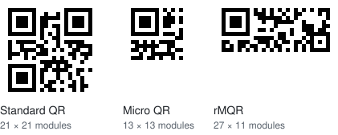

# qrkit

[](https://github.com/nao1215/qrkit/actions/workflows/ci.yml)

[](https://github.com/nao1215/qrkit/actions/workflows/gitleaks.yml)
[](https://github.com/nao1215/qrkit/actions/workflows/trivy.yml)
[](https://github.com/nao1215/qrkit/actions/workflows/quality.yml)
[](https://github.com/nao1215/qrkit/actions/workflows/osv-scan.yml)
[](https://hex.pm/packages/qrkit)
[](https://hexdocs.pm/qrkit/)
[](https://hex.pm/packages/qrkit)
[](./LICENSE)
[](https://scorecard.dev/viewer/?uri=github.com/nao1215/qrkit)

QR code encoder and decoder written in pure Gleam, for the Erlang and JavaScript targets. It writes Standard QR, Micro QR and rMQR symbols, renders them for the terminal, as SVG or as PNG, and reads module matrices back.



```sh
gleam add qrkit@0
```

```gleam
import gleam/io
import qrkit

pub fn main() {
  let assert Ok(qr) = qrkit.encode("https://github.com/sponsors/nao1215")
  io.println(qrkit.to_terminal(qr, style: qrkit.HalfBlocks, margin: 4))
}
```


`QrCode` is a plain record, so `qr.version`, `qr.width` and `qr.rows` can be read directly. To change how a symbol is built or drawn, update the default options:

```gleam
import gleam/option.{None}
import qrkit

pub fn label() -> Result(String, qrkit.EncodeError) {
  let options =
    qrkit.EncodeOptions(
      ..qrkit.default_encode_options(),
      symbol: qrkit.Rectangular,
      rectangular_priority: qrkit.ShortestHeight,
    )
  case qrkit.encode_with("https://github.com/sponsors/nao1215", options) {
    Ok(qr) ->
      Ok(qrkit.to_svg(
        qr,
        qrkit.ImageOptions(..qrkit.default_image_options(), light_color: None),
      ))
    Error(error) -> Error(error)
  }
}
```

`qrkit.decode(qr.rows)` reads a symbol back, and `qrkit.wifi`, `qrkit.vcard_to_string`, `qrkit.calendar_event_to_string` and the other payload functions build the text that phones act on.

## Things to know

- Many phone scanner apps cannot read Micro QR or rMQR, and some read Structured Append symbols from `encode_split` one by one without joining them. Test the target reader first.
- Micro QR has no High error correction and M1 takes only Low, while rMQR takes only Medium and High. Other levels return `ErrorCorrectionNotSupported`. M1 holds digits only.
- Byte data is always UTF-8, and without an ECI readers guess the character set: zbar misreads about 30% of them as Shift JIS. Set `eci: Some(26)` to say UTF-8; kanji are then written as UTF-8 bytes instead of Kanji mode, which can need a larger version. Other ECI values change only the header, so readers that honour them misread non-ASCII text.
- `decode` reads a grid of modules, not a photo. Finding a symbol in a camera image is out of scope.
- qrkit does not check the payload. A `javascript:` URI or an attacker-controlled string reaches the scanning app as given. The SVG output escapes the colours and nothing else, so sanitise it before embedding it in untrusted HTML.

Further documentation can be found at <https://hexdocs.pm/qrkit/>.

## Other readers

Every pull request checks that zxing-cpp and zbar read random symbols qrkit writes, and that qrkit reads symbols segno writes, the same way zxing-cpp does. A single disagreement fails the check, except for zbar on non-ASCII text without an ECI, which is recorded only.


[Counts and versions](https://github.com/nao1215/qrkit/blob/main/doc/interop.md) · [How qrkit is tested, with mutation scores](https://github.com/nao1215/qrkit/blob/main/doc/testing.md)

## Verifying releases

Each GitHub Release attaches the tarball published to Hex (`qrkit-<version>.tar`), `checksums.txt`, a cosign signature bundle (`checksums.txt.sigstore.json`) and build provenance (`qrkit-<version>.intoto.jsonl`). The release workflow downloads the tarball from Hex after `gleam publish` and checks it against the checksum Hex records before signing it, so the tarball you get from Hex is the one that is signed and attested.

```sh
curl -fsSLO https://repo.hex.pm/tarballs/qrkit-<version>.tar
gh attestation verify qrkit-<version>.tar --repo nao1215/qrkit
```

To check the signature as well, download `checksums.txt` and `checksums.txt.sigstore.json` from the Release into the same directory. The workflow runs on the release tag, or on `main` when the assets of a published tag are attached again.

```sh
cosign verify-blob \
  --bundle checksums.txt.sigstore.json \
  --certificate-identity-regexp '^https://github\.com/nao1215/qrkit/\.github/workflows/release\.yml@refs/(tags/v.+|heads/main)$' \
  --certificate-oidc-issuer https://token.actions.githubusercontent.com \
  checksums.txt
sha256sum --check checksums.txt
```
