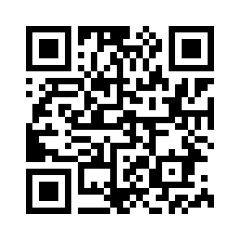

# qrkit

[](https://github.com/nao1215/qrkit/actions/workflows/ci.yml)
[](https://github.com/nao1215/qrkit/actions/workflows/gitleaks.yml)
[](https://github.com/nao1215/qrkit/actions/workflows/trivy.yml)
[](https://github.com/nao1215/qrkit/actions/workflows/osv-scan.yml)
[](https://hex.pm/packages/qrkit)
[](https://hexdocs.pm/qrkit/)
[](https://hex.pm/packages/qrkit)
[](./LICENSE)
[](https://scorecard.dev/viewer/?uri=github.com/nao1215/qrkit)

Pure-Gleam QR code generator and decoder for the Erlang and JavaScript targets.

It covers Standard QR (versions 1 to 40, ECC L/M/Q/H), Micro QR (M1 to M4), rMQR (ISO/IEC 23941, 32 sizes) and Structured Append, with Kanji mode for all of JIS X 0208 and segmentation that picks the fewest bits. It renders to the terminal, SVG and PNG, decodes module matrices with Reed-Solomon error correction, and builds WiFi, vCard, email, SMS, phone, geo and calendar payloads.

The QR below was rendered by qrkit and points to the project's GitHub Sponsors page.



```sh
gleam add qrkit
```

## Hello, QR

```gleam
import gleam/io
import qrkit

pub fn main() {
  let assert Ok(qr) = qrkit.encode("https://github.com/sponsors/nao1215")
  io.println(qrkit.to_terminal(qr, style: qrkit.Blocks, margin: 4))
}
```

`qrkit.encode/1` picks the smallest version that fits and uses ECC level Medium. `QrCode` is a plain record: `qr.version`, `qr.width`, `qr.rows` and the other fields can be read directly.

## Options for ECC, exact version, and ECI

```gleam
import gleam/option.{Some}
import qrkit

pub fn high_density_qr() -> qrkit.QrCode {
  let assert Ok(qr) =
    qrkit.encode_with(
      "https://github.com/sponsors/nao1215",
      qrkit.EncodeOptions(
        ..qrkit.default_encode_options(),
        error_correction: qrkit.Quartile,
        version: Some(4),
        eci: Some(26),
      ),
    )
  qr
}
```

`version: Some(n)` pins the symbol version; `encode_with` returns `Error(DataExceedsCapacity)`, `Error(ErrorCorrectionNotSupported)` or `Error(UnsupportedCharacter)` if the payload, mode or ECC level does not fit there. `eci` prepends an Extended Channel Interpretation header (26 for UTF-8) and works on Standard QR only.

## Render as SVG for the browser

```gleam
import qrkit

pub fn render_svg() -> String {
  let assert Ok(qr) = qrkit.encode("https://github.com/sponsors/nao1215")
  qrkit.to_svg(qr, qrkit.default_image_options())
}
```

The result is a complete `<svg>` document. `ImageOptions` changes size, margin and colours:

```gleam
import gleam/option.{Some}
import qrkit

pub fn dark_themed_svg() -> String {
  let options =
    qrkit.ImageOptions(
      module_size: 12,
      margin: 2,
      dark_color: "#22d3ee",
      light_color: Some("#0f172a"),
    )

  let assert Ok(qr) = qrkit.encode("https://github.com/sponsors/nao1215")
  qrkit.to_svg(qr, options)
}
```

## Write a PNG to disk

```gleam
import qrkit

pub fn render_png_bytes() -> BitArray {
  let assert Ok(qr) = qrkit.encode("https://github.com/sponsors/nao1215")
  qrkit.to_png(qr, qrkit.default_image_options())
}
```

`qrkit.to_png/2` returns raw PNG bytes. On the Erlang target, `simplifile` can write them:

```gleam
import qrkit
import simplifile

pub fn save_png() -> Result(Nil, simplifile.FileError) {
  let assert Ok(qr) = qrkit.encode("https://github.com/sponsors/nao1215")
  qrkit.to_png(qr, qrkit.default_image_options())
  |> simplifile.write_bits("qr.png", _)
}
```

## ASCII for the terminal

`qrkit.Blocks` draws `██` full blocks. `qrkit.HalfBlocks` uses `▀`/`▄` half-blocks at half the height, and `qrkit.InvertedBlocks` swaps light and dark for dark-themed terminals. A margin of 4 modules is the quiet zone scanners expect.

```gleam
import gleam/io
import qrkit

pub fn main() {
  let assert Ok(qr) = qrkit.encode("https://github.com/sponsors/nao1215")
  io.println(qrkit.to_terminal(qr, style: qrkit.HalfBlocks, margin: 4))
}
```

It prints the following (the blank lines above and below are the quiet zone):

```
                                     
                                     
    █▀▀▀▀▀█ ▄ ▀ █▄▀  ▀██▄ █▀▀▀▀▀█    
    █ ███ █  █▄▀█▄ ▀  █▀  █ ███ █    
    █ ▀▀▀ █ ▀█ ▀▄▀▄▄▀  █  █ ▀▀▀ █    
    ▀▀▀▀▀▀▀ ▀ ▀ █ ▀▄▀▄█▄▀ ▀▀▀▀▀▀▀    
    █▄▀▄▀▄▀▄ █▀▀▀▄ ▄▄▀  ▄ ▄ ▀▄ ▀▄    
    █▄▄ ▄ ▀█  ▀▀█▄█▄ █▄  ▀▀▄█ ▀█▀    
    ▄▄▀▀  ▀█ ▄▄ █ █▀▄█▄ ▄██  █ ▀█    
     ▄█▀▄▄▀ ▀▀▀▀ ▀ ▄▀█▀ ▄▄█ ▀█ █▀    
    ▀▀▀▄▄▀▀ ▄▀█▀ ▄ ▄ █▄▀▀▄█▀ █▄▀█    
    ▀▄▀▀▄█▀▀ ▀▀ ▄▄█▄▀██▄▄█▄██▄ █▀    
    ▀  ▀▀▀▀ █▀▀▀  █▄ ▀▀██▀▀▀█ ▄▄▄    
    █▀▀▀▀▀█  ██▀▄▀  ▄█▄▀█ ▀ ██ ▀█    
    █ ███ █ ▀▀█▀█▄ ▀█▀  █▀▀██ ▄▀     
    █ ▀▀▀ █ ▀█▄▄█  ▄ █ █▄▄ ▀█▀ ▄▀    
    ▀▀▀▀▀▀▀ ▀   ▀ ▀ ▀▀ ▀▀▀ ▀▀  ▀▀    
                                     
                                     
```

## Payload helpers

```gleam
import qrkit

pub fn wifi_qr_svg() -> String {
  let payload =
    qrkit.wifi(ssid: "MyAP", security: qrkit.Wpa2("secret"), hidden: False)
  let assert Ok(qr) = qrkit.encode(payload)
  qrkit.to_svg(qr, qrkit.default_image_options())
}
```

```gleam
import gleam/option.{Some}
import qrkit

pub fn contact_qr() -> Result(qrkit.QrCode, qrkit.EncodeError) {
  qrkit.VCard(
    ..qrkit.vcard("Naohiro Chikamatsu"),
    email: Some("nao@example.com"),
    phone: Some("+81-90-0000-0000"),
    url: Some("https://github.com/nao1215"),
  )
  |> qrkit.vcard_to_string
  |> qrkit.encode
}

pub fn mail_qr() -> Result(qrkit.QrCode, qrkit.EncodeError) {
  qrkit.email(to: "you@example.com", subject: "Hi", body: "Quick note")
  |> qrkit.encode
}

pub fn sms_qr() -> Result(qrkit.QrCode, qrkit.EncodeError) {
  qrkit.sms(to: "+819000000000", body: "Hello!") |> qrkit.encode
}

pub fn phone_qr() -> Result(qrkit.QrCode, qrkit.EncodeError) {
  qrkit.phone("+819000000000") |> qrkit.encode
}

pub fn map_pin_qr() -> Result(qrkit.QrCode, qrkit.EncodeError) {
  qrkit.geo(latitude: 35.6812, longitude: 139.7671) |> qrkit.encode
}
```

```gleam
import gleam/option.{Some}
import gleam/time/timestamp
import qrkit

pub fn meeting_qr() -> Result(qrkit.QrCode, qrkit.EncodeError) {
  // 2026-05-14 10:00 UTC, ends 11:00 UTC.
  let time =
    qrkit.Timed(
      start: timestamp.from_unix_seconds(1_778_752_800),
      end: timestamp.from_unix_seconds(1_778_756_400),
    )
  qrkit.CalendarEvent(
    ..qrkit.calendar_event("Sync", time),
    location: Some("Online"),
    description: Some("Project sync meeting"),
  )
  |> qrkit.calendar_event_to_string
  |> qrkit.encode_with(
    qrkit.EncodeOptions(..qrkit.default_encode_options(), error_correction: qrkit.Low),
  )
}
```

`qrkit.AllDay(first:, last:)` takes `calendar.Date` values and includes both days.

## Decode a module matrix

`qrkit.decode` reads a Standard QR, Micro QR or rMQR symbol from rows of modules (the shape of `QrCode.rows`) and corrects damaged codewords. It strips a light quiet zone, reads rotated and mirrored symbols, and reads Byte data as ISO-8859-1 under ECI 1 or 3, Shift JIS under ECI 20 and UTF-8 under ECI 26. With any other ECI, or none, it guesses between UTF-8, Shift JIS and ISO-8859-1 as zxing does.

```gleam
import qrkit

pub fn round_trip() -> Result(String, qrkit.DecodeError) {
  let assert Ok(qr) = qrkit.encode("https://github.com/sponsors/nao1215")
  case qrkit.decode(qr.rows) {
    Ok(decoded) -> Ok(decoded.text)
    Error(error) -> Error(error)
  }
}
```

`Decoded` also reports `errors_corrected`, `error_correction`, `version`, `eci` and `structured_append`. Errors are `NotASymbol(width, height)`, `UnreadableFormatInformation`, `TooManyErrors` and `MalformedData`.

## Micro QR, rMQR and Structured Append

Many consumer scanner apps cannot read Micro QR or rMQR, and some decode Structured Append symbols one by one without joining them. Test the target reader first.

Micro QR fits a small payload into 11×11 to 17×17 modules. M1 takes Numeric only, M2 adds Alphanumeric, and M3 and M4 take all four modes. ECC levels follow ISO/IEC 18004 Annex K: M1 has error detection only, and M4 goes up to Quartile.

```gleam
import gleam/option.{Some}
import qrkit

pub fn business_card_qr() -> String {
  let assert Ok(qr) =
    qrkit.encode_with(
      "01234567",
      qrkit.EncodeOptions(
        ..qrkit.default_encode_options(),
        symbol: qrkit.Micro,
        version: Some(2),
        error_correction: qrkit.Low,
      ),
    )

  qrkit.to_svg(qr, qrkit.default_image_options())
}
```

rMQR (ISO/IEC 23941) has 32 rectangular sizes from 7×43 to 17×139, with Medium and High error correction only.

```gleam
import qrkit

pub fn label_qr() -> String {
  let assert Ok(qr) =
    qrkit.encode_with(
      "https://github.com/sponsors/nao1215",
      qrkit.EncodeOptions(
        ..qrkit.default_encode_options(),
        symbol: qrkit.Rectangular,
        error_correction: qrkit.Medium,
        rectangular_priority: qrkit.ShortestHeight,
      ),
    )

  qrkit.to_svg(qr, qrkit.default_image_options())
}
```

By default the encoder picks the size with the fewest modules (`qrkit.SmallestArea`). `qrkit.ShortestHeight` picks the lowest symbol, `qrkit.NarrowestWidth` the narrowest, and `version: Some(n)` pins one size.

`qrkit.encode_split` splits a payload across up to 16 symbols, each with the ISO/IEC 18004 §8.2 Structured Append header (mode indicator, symbol position, total − 1, parity byte).

```gleam
import gleam/list
import qrkit

pub fn split_long_message() -> List(String) {
  let payload = "Lorem ipsum dolor sit amet, consectetur adipiscing elit."

  let assert Ok(shards) =
    qrkit.encode_split(payload, max_version: 2, error_correction: qrkit.Medium)
  list.map(shards, qrkit.to_terminal(_, style: qrkit.Blocks, margin: 4))
}
```

If the payload fits in one symbol at `max_version`, the list holds a single QR without the header.

## Force a single encoding mode

`mode: qrkit.ForceByte` skips segmentation and encodes the whole string as bytes.

```gleam
import qrkit

pub fn raw_byte_qr() -> Result(qrkit.QrCode, qrkit.EncodeError) {
  qrkit.encode_with(
    "123-ABC",
    qrkit.EncodeOptions(..qrkit.default_encode_options(), mode: qrkit.ForceByte),
  )
}
```

## Errors

Every encoding function returns `Result(_, qrkit.EncodeError)` instead of crashing:

- `EmptyInput`: empty `data`.
- `InvalidVersion(requested)`: version outside the symbol family.
- `InvalidEciDesignator(designator)`: ECI assignment number outside `0..999999`.
- `DataExceedsCapacity(bits_needed, bits_available)`: payload does not fit.
- `UnsupportedCharacter(at_index, character)`: a pinned Micro QR version has no mode for this character.
- `ErrorCorrectionNotSupported(symbol, error_correction)`: such as rMQR with Low ECC.
- `EciNotSupported(symbol)`: ECI on Micro QR or rMQR.

```gleam
import qrkit

pub fn rejected() -> Bool {
  case qrkit.encode("") {
    Error(qrkit.EmptyInput) -> True
    _ -> False
  }
}
```

CI tests both the Erlang and JavaScript targets. PNG rendering and Reed-Solomon are pure Gleam, with no NIF or native binary.

API reference: <https://hexdocs.pm/qrkit/>.

## Scope and non-goals

- qrkit decodes module matrices, not photos. Finding a symbol in an image (detection, perspective correction, thresholding) is out of scope.
- Kanji mode covers the characters of JIS X 0208. Characters outside it (CP932 extensions such as circled digits, and JIS X 0213 additions) are encoded in Byte mode as UTF-8.
- Model 1 QR (the pre-1997 specification) is not implemented; only Model 2 (ISO/IEC 18004:2015), Micro QR, and rMQR.
- The encoder does not normalise input: no trimming, no Unicode normalisation, no `\r\n` ↔ `\n` rewrites, no NUL truncation. What you pass is what a reader decodes.
- Whether a symbol scans also depends on quiet zone, contrast, module size, print scale, medium and scanner. Test on the target devices.

## Safety notes

- qrkit does not check the payload. A `javascript:` URI, an otpauth secret or attacker-controlled text reaches the scanning app as is, so validate before encoding.
- The SVG renderer escapes `dark_color` and `light_color` so they cannot break out of the `fill="..."` attribute, and does no other escaping. Run the output through a sanitiser such as DOMPurify before embedding it in untrusted HTML.
- `EncodeError` never contains the payload, except `UnsupportedCharacter`, which reports the offending character. Handle that error before logging if the payload is secret, such as a TOTP seed.

## Testing

| Technique | Bug class caught here |
|---|---|
| Examples and unit tests | [Wrong matrices, capacities and errors](doc/testing.md#examples-and-unit-tests) |
| Generated properties | [Round trips that lose data, uncorrected damage, decoder crashes](doc/testing.md#generated-properties) |
| Metamorphic relations | [Wrong size choice, orientation and quiet zone handling](doc/testing.md#metamorphic-relations) |
| Snapshots | [Unreviewed changes to symbols and rendered output](doc/testing.md#snapshots) |
| Differential testing | [Symbols other readers cannot read, misread foreign symbols](doc/testing.md#differential-testing) |
| Mutation testing | [Assertions that miss a changed operator or branch](doc/testing.md#mutation-testing) |

## Verifying releases

Each GitHub Release attaches the Hex package tarball (`qrkit-<version>.tar`),
`checksums.txt`, a cosign signature bundle (`checksums.txt.sigstore.json`) and
build provenance (`qrkit-<version>.intoto.jsonl`). Download the assets, then:

```sh
gh attestation verify qrkit-<version>.tar --repo nao1215/qrkit

cosign verify-blob \
  --bundle checksums.txt.sigstore.json \
  --certificate-identity-regexp '^https://github\.com/nao1215/qrkit/\.github/workflows/release\.yml@refs/tags/v' \
  --certificate-oidc-issuer https://token.actions.githubusercontent.com \
  checksums.txt
sha256sum --check checksums.txt
```

## License

[MIT](LICENSE)
