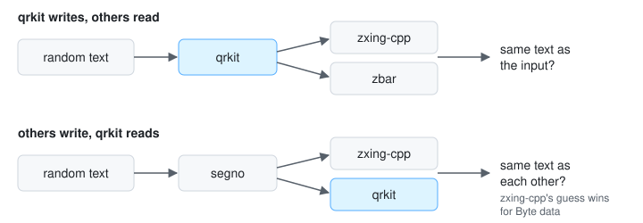
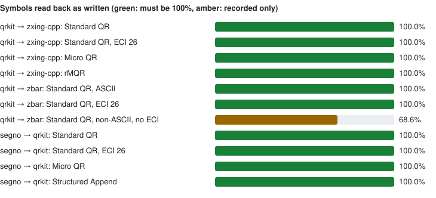

# Interoperability

qrkit is checked against three independent implementations: [zxing-cpp](https://github.com/zxing-cpp/zxing-cpp) and [zbar](https://github.com/mchehab/zbar) read the symbols qrkit writes, and qrkit reads the symbols [segno](https://github.com/heuer/segno) writes.



The text is random: digits, upper-case letters, kana, kanji, Latin-1, an emoji and newlines, mixed so that every mode and segment boundary is reached. Symbols are drawn at 6 pixels per module with a quiet zone, so the readers see a clean image and any failure comes from the modules themselves.

## Results



<!-- interop:start -->
Measured on 2026-11-27 with zxing-cpp 3.1.1, zbar 0.23.93, segno 1.6.6.

| Writer | Reader | Symbols | Read | Rate | Gate |
|---|---|---|---:|---:|---|
| qrkit | zxing-cpp | Standard QR | 1015 / 1015 | 100.0% | must be 100% |
| qrkit | zxing-cpp | Standard QR, ECI 26 | 1002 / 1002 | 100.0% | must be 100% |
| qrkit | zxing-cpp | Micro QR | 339 / 339 | 100.0% | must be 100% |
| qrkit | zxing-cpp | rMQR | 946 / 946 | 100.0% | must be 100% |
| qrkit | zbar | Standard QR, ASCII | 115 / 115 | 100.0% | must be 100% |
| qrkit | zbar | Standard QR, ECI 26 | 1002 / 1002 | 100.0% | must be 100% |
| qrkit | zbar | Standard QR, non-ASCII, no ECI | 617 / 900 | 68.6% | recorded only |
| segno | qrkit | Standard QR | 1556 / 1556 | 100.0% | must be 100% |
| segno | qrkit | Standard QR, ECI 26 | 1022 / 1022 | 100.0% | must be 100% |
| segno | qrkit | Micro QR | 211 / 211 | 100.0% | must be 100% |
| segno | qrkit | Structured Append | 2211 / 2211 | 100.0% | must be 100% |
<!-- interop:end -->

Green groups fail the pull request and the nightly run if a single symbol disagrees. The amber group is recorded only. Byte data without an ECI has no agreed character set. The 2000 edition of ISO/IEC 18004 defaults to JIS8 and later editions to ISO-8859-1, so readers guess: zxing-cpp guesses UTF-8 and zbar guesses Shift JIS. Pass `eci: Some(26)` when the text is not ASCII and the reader is unknown.

## Running it

Pull requests run a small corpus (`just interop`); the nightly job runs a larger one. The table above comes from `just interop-record`, which needs the packages in `scripts/interop-requirements.txt` and libzbar0:

```sh
python3 -m venv .venv
.venv/bin/pip install --require-hashes --no-deps -r scripts/interop-requirements.txt
sudo apt-get install libzbar0
PYTHON=.venv/bin/python just interop-record
```
