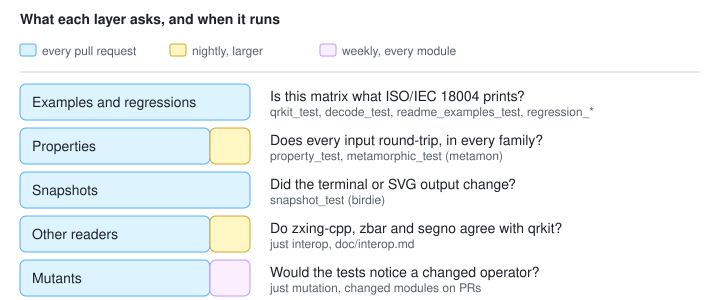
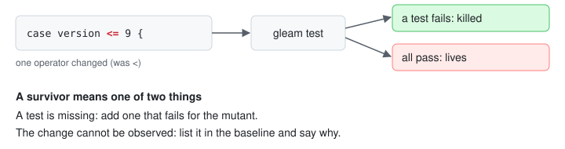

# Testing

`just ci` runs the tests on the Erlang and JavaScript targets. CI also runs them on the Gleam floor (1.14.0, OTP 27, Node 22) and on the latest Gleam 1.x.

| Layer | Bug it catches | Where |
|---|---|---|
| Examples and regressions | A matrix, capacity or error that differs from ISO/IEC 18004 or ISO/IEC 23941 | `test/qrkit_test.gleam`, `test/decode_test.gleam`, `test/regression_*_test.gleam` |
| README examples | A README snippet that no longer compiles or runs | `test/readme_examples_test.gleam` |
| Properties | An input that does not round-trip | `test/property_test.gleam` |
| Metamorphic relations | Two runs that disagree when one input is a transformed copy of the other | `test/metamorphic_test.gleam` |
| Snapshots | A change in terminal or SVG output | `test/snapshot_test.gleam` |
| Fixed symbols from segno | A mask pattern or character-set guess that only round-trips with qrkit's own encoder | `test/fixtures/segno_symbols.tsv`, written by `scripts/interop.py fixtures` |
| Other readers | A symbol that only qrkit can read | `just interop`, [interop.md](interop.md) |
| Mutants | Code the tests run but do not check | `just mutation`, below |

## Properties and relations

The generators in `test/generators.gleam` mix ASCII, digits, kana, kanji, Latin-1, an emoji and newlines so every mode and segment boundary is reached. `test/property_test.gleam` checks that encoding then decoding returns the input for every symbol family and level, that one flipped module is corrected, and that random or damaged grids give an error instead of a crash.

`test/metamorphic_test.gleam` checks relations where the exact output cannot be written down:

- A longer text never gives a smaller symbol, including across the version 9/10 and 26/27 boundaries where the character-count fields get wider.
- A higher error correction level never gives a smaller symbol.
- A turned, mirrored or padded symbol decodes to the same text, version, level and mask.

The nightly job runs the suite ten times with `METAMON_RUNS_MULTIPLIER=10`, each pass with a new seed. A failure prints its seed; replay it with `metamon.with_seed` and keep it as a regression test.

## Snapshots

`test/snapshot_test.gleam` keeps birdie snapshots of the terminal and SVG output. The SVG snapshot has one path command per line, so a changed module is a changed line. Every snapshot symbol is also decoded, so an accepted snapshot is known to read back. Review changes with `gleam run -m birdie`.

## Mutation testing

`gleam run -m metamon/mutation` ([metamon](https://hexdocs.pm/metamon/metamon/mutation.html), which started as this repository's `dev/mutation.gleam`) parses each module with [glance](https://hex.pm/packages/glance), changes one operator or boolean at a time, and runs `gleam test --target erlang` in a copy of the project:

- `==` and `!=` swapped, `<` and `<=`, `>` and `>=` moved across the boundary, for integers and floats
- `&&` and `||` swapped, `!` dropped, `True` and `False` swapped in expressions
- `+` and `-` swapped, `*` and `/` swapped, `%` changed to `*`, for integers and floats

`src/qrkit/internal/kanji_table.gleam` is generated data and is left out with `--exclude`. The score is killed / (killed + lived + timed out), counting a timed-out mutant as killed. A mutant that does not compile is not counted.

<!-- mutation:start -->
| Module | Killed | Lived | Timed out | Score |
|---|---:|---:|---:|---:|
| `qrkit` | 59 | 6 | 0 | 90.8% |
| `qrkit/internal/bitstream` | 11 | 0 | 0 | 100.0% |
| `qrkit/internal/decode` | 101 | 22 | 0 | 82.1% |
| `qrkit/internal/format_info` | 13 | 1 | 1 | 93.3% |
| `qrkit/internal/mask` | 67 | 10 | 0 | 87.0% |
| `qrkit/internal/matrix` | 26 | 1 | 1 | 96.4% |
| `qrkit/internal/micro` | 113 | 21 | 0 | 84.3% |
| `qrkit/internal/mode` | 35 | 6 | 0 | 85.4% |
| `qrkit/internal/png` | 15 | 0 | 1 | 100.0% |
| `qrkit/internal/reed_solomon` | 48 | 9 | 1 | 84.5% |
| `qrkit/internal/rmqr` | 141 | 22 | 1 | 86.6% |
| `qrkit/internal/segment` | 17 | 14 | 0 | 54.8% |
| `qrkit/internal/standard` | 111 | 6 | 0 | 94.9% |
| `qrkit/internal/structured_append` | 12 | 6 | 0 | 66.7% |
| `qrkit/internal/svg` | 15 | 0 | 0 | 100.0% |
| `qrkit/internal/terminal` | 1 | 0 | 0 | 100.0% |
| `qrkit/internal/util` | 8 | 0 | 0 | 100.0% |
| `qrkit/internal/version` | 12 | 1 | 0 | 92.3% |
| all | 805 | 125 | 5 | 86.6% |
<!-- mutation:end -->

Pull requests mutate the modules they change and fail on a survivor that `doc/mutation/baseline.json` does not list, matched by module, function, mutator, line text and the column in that text. The weekly run mutates every module. The property tests draw a new seed each run, so a survivor is run three times before it counts. After a full run, `just mutation-record` updates the baseline and the table above.

The survivors left in the baseline, grouped:

- Mask patterns (10): `(row + col) % 2` and `(row - col) % 2` have the same parity, and so do the other mask formulas with `+` changed to `-`. No test can tell them apart.
- Shift JIS guess for Byte data without an ECI (16): the thresholds of a heuristic that copies zxing-cpp's. The 143 Byte fixtures agree with zxing-cpp, but none sits exactly on these edges with a different answer.
- Ties (16): `<` against `<=` between two costs or mask penalties only changes which of two equally good choices wins. The symbol still decodes, and the interop job reads it with other readers.
- Reserved flags (11): modules marked reserved by an earlier call, or set light in an area a later step overwrites.
- Checked values (33): range checks on values the caller has already validated or clamped, such as versions, ECI designators, denominators and years.
- Other (39): loop bounds and index arithmetic whose change gives the same output, such as the symmetric alignment pattern, terminator bits that padding absorbs, and the position in an error for a character the segmenter never sends to that mode.
